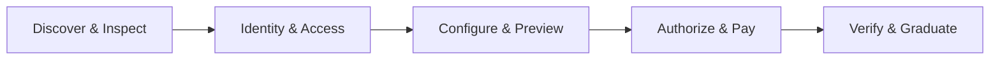

# DESIGN.md: coiner.dev UI/UX Design Contract

> **Status:** Live  
> **Owner:** Syamsul Alam (`admin@alampintar.org`)  
> **Last updated:** 2026-11-18  
> **Project:** coiner.dev — Sovereign Solana Token Creator  
> **Design guide:** `KNOWLEDGE/DESIGN-GUIDE.md` in the OneDrive MD hub  
> **Enforcement skill:** `ui-ux-design-contract`

---

## 1. Product and Users

### 1.1 Product

`coiner.dev` is a sovereign, non-custodial Solana SPL and meme coin creation studio that enables crypto founders, degens, and community builders to deploy fully compliant, RugCheck A-Grade tokens in a single atomic on-chain transaction. It eliminates predatory third-party platform markups through a transparent Dual-Tier Fee Model: public creators pay a flat 0.15 SOL bundled service fee with all 3 security revocations (Freeze, Mint, Update) and IPFS metadata pinning included 100% free with zero upsell (while non-standard customizations to retain any authority incur +0.05 SOL each), and the platform owner receives a 0.00 SOL fee exemption when connecting an authorized admin Solana wallet (`2di9sSnh1BYixnNw7Hw47XbMet9J5HFdF8NUMN2LZmaV`).

### 1.2 Primary users

| User | Job to be done | Context | Success signal |
|---|---|---|---|
| Platform Owner (Syamsul) | Launch experimental degen and portfolio coins with zero platform markups and zero friction. | Desktop ThinkPad, Phantom wallet, admin wallet allowlist. | Token deployed at raw gas cost (~0.0168 SOL) with 100% supply in creator ATA. |
| Meme Coin Degen | Deploy a viral meme token in under 15 seconds to seize social sentiment or trending hashtags. | Desktop or mobile Web3 browser (Phantom/Solflare app), time-sensitive trading environment. | A-grade RugCheck score, instant Raydium CPMM link, zero smart contract lockup. |
| Community Web3 Founder | Launch a utility or governance token with fixed supply and permanent authority revocations. | Desktop browser, formal treasury management, strict security requirements. | Clean Metaplex V3 metadata, immutable supply verified on Solscan, zero rug risk. |

### 1.3 Success metrics

- **Deployment Velocity:** Under 15 seconds from Form Submission to on-chain transaction confirmation.
- **RugCheck Rating:** 100% "Good" / A-Grade score on RugCheck.xyz (Freeze Revoked, Mint Revoked, Metadata Immutable).
- **Transaction Success Rate:** > 99.0% first-attempt broadcast finality on Solana Mainnet and Devnet.
- **Conversion Efficiency:** > 65% of wallet-connected visitors who input a ticker successfully trigger deployment.

---

## 2. User Flow and Journey

### 2.1 Primary journey

| Stage | User goal | Entry point | Pages or screens | Exit and next stage |
|---|---|---|---|---|
| Discover & Inspect | Understand pricing transparency, verify zero platform markup or 0.15 SOL flat bundled fee, and review security standards. | Direct URL (`https://coiner.dev`) or Twitter/Telegram link. | Token Creator Studio | Configure & Preview |
| Identity & Access | Connect admin Solana wallet to activate automatic 0.00 SOL platform fee exemption. | Connect admin Solana wallet (`2di9sSnh1BYixnNw7Hw47XbMet9J5HFdF8NUMN2LZmaV`). | Admin Status Badge | Configure & Preview |
| Configure & Preview | Define token parameters (name, symbol, supply, decimals, logo) and inspect real-time DEX card simulation. | Connected wallet on homepage. | Token Creator Studio | Authorize & Pay |
| Authorize & Pay | Sign the single atomic transaction in Phantom/Solflare and settle platform fee (0.15 SOL Public Bundled / 0.00 SOL Admin). | "Create Token" CTA click. | Launch & Settlement Modal | Verify & Graduate |
| Verify & Graduate | Copy mint address, verify metadata on Solscan, audit safety on RugCheck, and create Raydium CPMM pool. | On-chain confirmation. | Launch & Settlement Modal | Raydium pool creation or Solscan explorer |

### 2.2 Journey diagram

### 2.3 Alternate and edge-case paths

- **Admin Authentication Flow:** Platform owner connects their allowlisted admin Solana wallet (`2di9sSnh1BYixnNw7Hw47XbMet9J5HFdF8NUMN2LZmaV`), instantly toggling the studio into `👑 Admin Mode` with 0.00 SOL platform fee.
- **Devnet Sandbox Testing:** User toggles the top-right network switch to "Devnet" to test deployment risk-free with faucet SOL before committing mainnet capital.
- **RPC Rate-Limit Recovery:** If Solana public RPC nodes encounter heavy network congestion, the client falls back to cached rent values and informs the user to switch priority fees to Fast/Turbo.

---

## 3. Page and Screen Inventory

| ID | Page or Screen | Route or File | Journey Stage | Primary Action | Status |
|---|---|---|---|---|---|
| P-01 | Token Creator Studio | `src/components/CreatorPage.jsx` | Configure & Preview | Launch Token | Live |
| P-02 | Launch & Settlement Modal | `src/components/LaunchModal.jsx` | Authorize & Pay | Confirm Transaction & Copy Address | Live |
| P-03 | Admin Status Badge | `src/lib/admin.jsx` | Identity & Access | Connect Admin Wallet | Live |
| P-04 | Knowledge & Safety Guide | `src/components/StepGuide.jsx` & `FAQ.jsx` | Discover & Inspect | Review Raydium Guide & FAQs | Live |

---

## 4. Global Design Principles

### 4.1 Mandatory 13 Principle Baseline

The authoritative catalog is `KNOWLEDGE/DESIGN-GUIDE.md` in the OneDrive MD hub. The 13 principles below form the non-negotiable contract baseline across all studio surfaces.

| Principle | Global application | Page evidence required |
|---|---|---|
| Fitts's Law | Primary actions use their component dimensions; authority switches have 64×44px activation areas. Do not infer every secondary action meets 44px from the primary CTA. | Target size, spacing, and placement measured on each page. |
| Visual Hierarchy | Single dominant CTA per viewport with metallic gold gradient background (`from-amber-500 via-yellow-400 to-amber-500`); secondary inputs use deep obsidian panels with specular gradient outlines. | Heading order, contrast ratios, and action prominence. |
| Von Restorff Effect | Distinctive glowing gold badges (`#f59e0b`, `text-amber-300`) and 3D metallic coin emblem isolate key status elements from the dark background without green clash. | One highlighted element per view with documented justification. |
| Object Constancy | Header, navigation bar, wallet connection state, and network switch remain pinned in identical screen coordinates. | Persistent navigation and status placement across all views. |
| Snapping | Live preview card sticks smoothly to viewport top-24; priority fee buttons snap to 3-column equal-width grid. | Snap points, flex layouts, and sticky alignment rules. |
| Motion Blur | Spinners and progress pulses use smooth 200–300ms transitions without high-frequency flashing. | Motion duration, cubic-bezier easing, and reduced-motion fallbacks. |
| Natural Mapping | Form fields flow logically from identity (Name, Ticker, Logo) to economics (Decimals, Supply) to security toggles. | Control placement matching mental model of token issuance. |
| Tabular Figures | Numerical figures and currency metrics use clean, unified sans typography (`font-sans tnum` or proportional sans) ensuring seamless typographic unity. | Font feature settings and numeric column alignments. |
| Animate Only the Delta | When typing ticker or changing supply, only the affected text nodes in the preview card animate or re-render. | Selective DOM updates preserving parent card stability. |
| Inertia | Accordion expansion, modal backdrop fading, and button hover states feature smooth deceleration curves. | Momentum, spring physics, and CSS cubic transitions. |
| Multimodal Feedback | Token launch completion shows a success heading and mint details; copy actions show separate success or manual-copy feedback. | Multiple confirmation channels for consequential blockchain steps. |
| Visual Cues | Clear focus rings (`focus:border-amber-400`), disabled button opacity (50%), and hover gold specular glow across all interactive controls. | Distinct interactive states for hover, active, focus, and disabled. |
| Skeuomorphism | Live Dex Preview emulates a physical 3D metallic token card with avatar medallion and embossed gold badges to convey tangible asset ownership. | Real-world metaphors justifying improved conceptual clarity. |

### 4.2 Design Tokens and Visual System

- **Token source:** Tailwind CSS v4 variables and custom classes in `src/index.css`.
- **Typography:** Unified `Inter` / system sans-serif (`font-sans`) across all UI labels, inputs, tickers, stats, and badges, completely eliminating terminal monospace look.
- **Color and contrast:** Deep obsidian (`#09090b` / `#030712`), card panels (`#111827`, `bg-gray-900`), border boundaries (`#27272a`, `border-zinc-800`), metallic gold (`#f59e0b`, `#fbbf24`, `#d97706`), specular white/gray gradient outlines (`.shiny-card`, `.shiny-pill`, `.shiny-button`). Zero green/emerald/cyan visual elements. Targets WCAG AA minimum text contrast. Verified wallet gradient endpoint ratios are 9.778:1 and 6.592:1; no blanket AAA certification is claimed.
- **Spacing, radius, and shadow:** 8px base grid, rounded-xl (12px) for cards, rounded-lg (8px) for inputs, subtle gold glow shadows (`shadow-amber-500/20`).
- **Dark mode:** Exclusive obsidian dark theme native to high-end crypto/Web3 environments.

### 4.3 Accessibility Target

- **WCAG Level:** AA compliance.
- **Keyboard navigation:** Full tab-order navigation across all form controls, modals, image upload triggers, and wallet buttons with visible focus rings.
- **Touch targets:** Authority switches use 64x44px activation targets with explicit visible focus rings. Other controls retain their existing page contracts.
- **Reduced motion:** Obeys `prefers-reduced-motion: reduce` by disabling non-essential pulse, shimmer, and float animations.

### 4.4 Performance Budget

- Initial required JavaScript target: **<200 KiB gzip**, measured from initial browser requests before any wallet/launch interaction. Lazy transaction, settlement, token-program, metadata and celebration modules are excluded only when the browser does not request them initially.
- FCP and INP targets are performance goals, not certificates. A loopback headless paint time does not establish 4G performance, INP, physical-mobile GPU throughput or 60fps.
- Verification commands and measured current byte totals live in the latest UI closure report; do not infer success from the entry-chunk size alone.

### 4.5 Motion Policy

- **Durations:** 150ms for micro-interactions (hover, press), 250ms for modal slide-ins, 300ms for accordion expansion.
- **Easing:** Standard `cubic-bezier(0.16, 1, 0.3, 1)` ease-out curve.
- **Prohibited motion:** Continuous looping rotations (except loading spinners during active blockchain awaits) or sudden layout shifts.

### 4.6 Content and Voice

- **Tone:** Sovereign, authoritative, transparent, and direct.
- **Microcopy:** Punchy, degen-friendly Web3 voice. Clean 0.15 SOL flat fee summary with all 3 revocations included free.
- **Error voice:** Actionable and transparent (e.g. "Transaction rejected by wallet" or "Image size exceeds 5MB limit").

---

## Art Direction

### Character
`coiner.dev` adopts a high-conviction "Sovereign Web3 Studio" visual character in Dark Obsidian, Crisp White, and Metallic Gold inspired by top-tier decentralized financial terminals. It intentionally repudiates low-trust cartoonish launchpad tropes, projecting cryptographic rigor, high execution velocity, and absolute transparency.

### Tokens
- Canvas: `#09090b` (Deep Obsidian)
- Surface Panels: `#111827` (Obsidian 900) with 90% opacity and 16px blur
- Hairline Boundaries: `#27272a` (Zinc 800) with specular gradient overlays
- Primary Energy / Authority: `#f59e0b` / `#fbbf24` (Metallic Gold)
- Typography: Clean `font-sans` throughout (zero monospace terminal font)
- Warning / Danger: `#ef4444` (Red 500)

### Build Mandate
Minimize layout shifts; no zero-CLS certification is claimed. All numeric currency metrics render in clean sans typography. Modals and overlays utilize hardware-accelerated transforms (`transform: translate3d`) to favor smooth rendering; physical-device frame-rate performance remains unmeasured.

### Composition Patterns
- **Split-Screen Studio:** Desktop view splits into a 7-column configuration workspace and a 5-column sticky real-time preview terminal.
- **Ambient Hero Depth:** Hero background features a subtle, atmospheric 3D Gold Solana Coin asset at low opacity/blur, leaving foreground headline copy crisp and readable with specular text outlines.
- **Progressive Disclosure:** Advanced security options (Revoke Freeze, Revoke Mint, Immutable) and transaction priority overrides are presented below primary identity fields, defaulting to maximum community safety.
- **Floating Status Anchor:** Navigation bar remains fixed to viewport top with blurred backdrop (`z-50 backdrop-blur-xl bg-[#09090b]/85`), preserving immediate visibility of connected wallet, network cluster, and administrative tier.

### Component and Usage Rules
- Brand identity: `public/favicon.svg` is the canonical gold Solana coin mark with metallic rim, obsidian background, and Solana three-bar gold motif. `src/components/CoinerLogo.jsx` renders the mark with crisp white wordmark `coiner` and gold `.dev` (`text-amber-400`).
- Buttons must always indicate active/disabled states with clear cursor changes (`cursor-pointer` vs `cursor-not-allowed`).
- Badges employ semi-transparent dark amber containers (`bg-amber-950/80 border-amber-500/40 text-amber-300`) with high-contrast text and 1px outer borders.
- Input fields must enforce visible focus rings with zero outline clipping.

---

## 5. Page-by-Page Contracts

### Page: Token Creator Studio

#### Purpose and Journey
Primary interface where users configure their Solana token parameters, inspect live visual previews, review clean all-inclusive service fee, and initiate atomic deployment.

#### Layout and Hierarchy
Two-column desktop grid (7:5 ratio): left column hosts the configuration form, right column hosts the sticky live preview and cost comparison cards. Header anchors global identity, admin widget, network switch, and wallet multi-button.

#### Components and States
- Input fields: Name, Symbol, Decimals, Supply, Image Upload, Social Links.
- Security toggles: Revoke Freeze, Revoke Mint, Immutable Metadata.
- Priority selector: Normal, Fast, Turbo buttons.
- Total cost summary card: Clear 0.15 SOL flat service fee with 4 included security checkmarks.
- States: Empty, Active typing, Wallet disconnected, Form invalid, Awaiting broadcast.

#### Accessibility
Basics inputs use linked labels; social inputs use explicit accessible names. The upload trigger supports Enter/Space and locked steps expose aria-disabled with a prerequisite explanation. Keyboard tab index flows sequentially down the form before entering the preview column. Contrast is checked against actual rendered foreground/background pairs; translucent surfaces require local sampling.

#### Responsive Behavior
Desktop: 2-column grid (`lg:grid-cols-12`). Tablet/Mobile: Stacks vertically (`grid-cols-1`) with the live preview card positioned below the form to maximize input ergonomics on touchscreens.

#### Motion and Feedback
Inputs feature 150ms border-color transitions on focus. Image dropzone shows dashed border highlight on drag-over. Priority fee buttons toggle active background instantly with 100ms easing.

#### Content and Forms
Labels clearly mark required fields with amber asterisks. Decimals input contains microcopy helper explaining meme standard (6) vs SPL standard (9).

#### Principle Adherence

| Principle | Application | Evidence |
|---|---|---|
| Fitts's Law | Primary "Create Token" CTA spans full form width (h-11 / 44px) directly under the cost summary. | [TokenForm.jsx](file:///C:/Users/THINKPAD/coiner.dev/src/components/TokenForm.jsx) button dimensions |
| Visual Hierarchy | Bold 24px CardTitle with Sparkles icon dominates; secondary toggles use compact 14px labels. | CardTitle leading CardHeader in [TokenForm.jsx](file:///C:/Users/THINKPAD/coiner.dev/src/components/TokenForm.jsx) |
| Von Restorff Effect | Gold "Admin Mode" badge or "Flat 0.15 SOL Bundle" badge visually isolates pricing status. | Custom badge with distinct background in [TokenForm.jsx](file:///C:/Users/THINKPAD/coiner.dev/src/components/TokenForm.jsx) |
| Object Constancy | Header remains sticky at top-0 (`bg-[#09090b]/85 backdrop-blur-xl`) through entire configuration journey. | Sticky header markup in [App.jsx](file:///C:/Users/THINKPAD/coiner.dev/src/App.jsx) |
| Snapping | Priority fee buttons snap into an equal 3-column grid (`grid-cols-3 gap-2`). | Grid layout in [TokenForm.jsx](file:///C:/Users/THINKPAD/coiner.dev/src/components/TokenForm.jsx) |
| Motion Blur | N/A: studio form elements update instantaneously on state changes without high-velocity spatial movement. | Form fields update in-place without animated layout translation |
| Natural Mapping | Field ordering mirrors token metadata specification: Name -> Symbol -> Decimals -> Supply -> Media -> Security. | Sequential DOM structure in [TokenForm.jsx](file:///C:/Users/THINKPAD/coiner.dev/src/components/TokenForm.jsx) |
| Tabular Figures | Fee summary uses clean font-sans ensuring seamless typographic unity across the card. | Clean sans styling in [TokenForm.jsx](file:///C:/Users/THINKPAD/coiner.dev/src/components/TokenForm.jsx) |
| Animate Only the Delta | Only changed text nodes in the live preview update on keystrokes; parent card layout remains frozen. | Local React state updates in [LivePreview.jsx](file:///C:/Users/THINKPAD/coiner.dev/src/components/LivePreview.jsx) |
| Inertia | Form scrolling employs native browser momentum with smooth boundary resistance. | Native OS touch-scroll momentum on parent `<main>` |
| Multimodal Feedback | Connect wallet prompt visually disables the submit button while displaying explanatory helper text. | Dynamic disabled text and button styling in [TokenForm.jsx](file:///C:/Users/THINKPAD/coiner.dev/src/components/TokenForm.jsx) |
| Visual Cues | Disabled submit button renders at 50% opacity with `cursor-not-allowed`; active button shows gold specular glow. | Tailwind utility classes `disabled:opacity-50 disabled:cursor-not-allowed` |
| Skeuomorphism | Live Preview card renders token avatar as an embossed medallion emulating a physical minted coin with floating 3D gold Solana coin. | Avatar frame styling in [LivePreview.jsx](file:///C:/Users/THINKPAD/coiner.dev/src/components/LivePreview.jsx) |

#### Verification
- Build verification: `pnpm run build` completed cleanly (0 errors).
- Local production-build fixtures exercise Devnet/Mainnet UI selection; deployment evidence is tracked separately.

---

### Page: Launch & Settlement Modal

#### Purpose and Journey
Orchestrates the multi-stage atomic transaction execution, providing real-time feedback during IPFS pinning, keypair generation, wallet signature approval, on-chain confirmation, and celebration.

#### Layout and Hierarchy
Centered modal dialog (`sm:max-w-lg max-h-[90dvh] overflow-y-auto`) with dark frosted backdrop. Hierarchy: Icon status indicator -> Step progress sequence -> Detailed status message -> Action footer.

#### Components and States
- Step list: 4 progress rows with dynamic icons (Circle, Spinning Loader, Amber Checkmark).
- Error state: RPC error description and confirmation-status control. Broadcast errors hide Try Again until an explicit failed RPC result; pending, missing and unavailable status keep it hidden. A confirmed signature without mint context links to Solscan instead of inventing token success.
- Success state: 3D Gold Coin, celebratory heading, token avatar preview, contract address copy box, Solscan link, RugCheck link, Raydium pool link, X share button.

#### Accessibility
Dialog enforces `role="dialog"` and `aria-modal="true"`. Focus is trapped inside the modal during active deployment; Escape key is disabled during active wallet signing to prevent transaction desynchronization. Copy button features explicit `aria-label`.

#### Responsive Behavior
Scales down gracefully on mobile viewports with `max-h-[90dvh] overflow-y-auto` and scrollable raw error container.

#### Motion and Feedback
Spinning loaders use standard CSS `animate-spin` (1s linear infinite). Decorative pulse/bounce/float settle within five seconds. Confetti stops on owner changes and when reduced-motion becomes active; it never starts under that preference.

#### Content and Forms
Clear plain-English progress messages: "Pinning Logo & Metadata to IPFS", "Assembling Atomic Solana Transaction", "Awaiting Wallet Approval", "Broadcasting & Confirming on Solana".

#### Principle Adherence

| Principle | Application | Evidence |
|---|---|---|
| Fitts's Law | Success action buttons (Solscan, RugCheck, Raydium) use the shared button dimensions in a 2-column grid. The modal scrolls within 90dvh on short screens. | Button grid layout in [LaunchModal.jsx](file:///C:/Users/THINKPAD/coiner.dev/src/components/LaunchModal.jsx) |
| Visual Hierarchy | Celebratory "$TOKEN is Live!" heading in 24px bold text leads the success state above secondary action links. | DialogTitle styling in [LaunchModal.jsx](file:///C:/Users/THINKPAD/coiner.dev/src/components/LaunchModal.jsx) |
| Von Restorff Effect | 3D Gold Coin and celebratory heading draw primary visual focus upon successful launch. | Top visual badge container in [LaunchModal.jsx](file:///C:/Users/THINKPAD/coiner.dev/src/components/LaunchModal.jsx) |
| Object Constancy | Modal maintains consistent width and centered screen anchor throughout all state transitions. | DialogContent max-width class `sm:max-w-lg` |
| Snapping | Action buttons in success dialog snap into a balanced 2-column grid with a full-width Raydium CTA. | Grid classes `grid grid-cols-2 gap-2.5` in [LaunchModal.jsx](file:///C:/Users/THINKPAD/coiner.dev/src/components/LaunchModal.jsx) |
| Motion Blur | N/A: status transitions use fade-in opacities rather than fast lateral panning. | State transitions use opacity fade without motion blur |
| Natural Mapping | Step progression maps sequentially from top to bottom (Step 1 Upload -> Step 2 Prepare -> Step 3 Sign -> Step 4 Broadcast). | Step mapping array order in [LaunchModal.jsx](file:///C:/Users/THINKPAD/coiner.dev/src/components/LaunchModal.jsx) |
| Tabular Figures | Mint address input box uses `font-sans text-xs` with high-contrast amber styling for readability. | Clean sans styling on address input in [LaunchModal.jsx](file:///C:/Users/THINKPAD/coiner.dev/src/components/LaunchModal.jsx) |
| Animate Only the Delta | Only active progress row icon toggles between pending circle, spinner, and checkmark. | ProgressStep icon condition in [LaunchModal.jsx](file:///C:/Users/THINKPAD/coiner.dev/src/components/LaunchModal.jsx) |
| Inertia | Modal entry and exit utilize standard Radix UI decelerated scale animation. | Radix Dialog entry transform in `@/components/ui/dialog` |
| Multimodal Feedback | Successful copy action displays "Copied to clipboard!" label and sets temporary clipboard timeout. | Copy feedback state in [LaunchModal.jsx](file:///C:/Users/THINKPAD/coiner.dev/src/components/LaunchModal.jsx) |
| Visual Cues | Error container renders in high-contrast red-950/30 background with red-500 border for instant recognition. | Error container styling in [LaunchModal.jsx](file:///C:/Users/THINKPAD/coiner.dev/src/components/LaunchModal.jsx) |
| Skeuomorphism | "Copied!" button simulates a physical stamping action with brief label feedback. | Temporary copied icon state change in [LaunchModal.jsx](file:///C:/Users/THINKPAD/coiner.dev/src/components/LaunchModal.jsx) |

#### Verification
- Local audit uses controlled wallet/RPC fixtures; signing is deliberately rejected. No actual token creation or on-chain finality is certified.
- Chrome CDP fixtures exercise clipboard success and rejection; cross-browser native clipboard certification is not claimed.

---

### Page: Admin Status Badge

#### Purpose and Journey
Enables the platform owner to verify their admin Solana wallet (`2di9sSnh1BYixnNw7Hw47XbMet9J5HFdF8NUMN2LZmaV`), instantly activating the 0.00 SOL platform fee exemption across the application with zero third-party authentication overhead.

#### Layout and Hierarchy
Compact header component embedded directly beside the network switcher and wallet button. When signed out or when a standard public user connects, remains hidden to keep the customer-facing interface clean; when the authorized admin wallet connects, displays a glowing gold badge with Crown icon and "0 SOL Fee" pill.

#### Components and States
- Public User / Disconnected: Hidden completely to preserve clean, distraction-free degen UX.
- Admin Connected: Crown icon + "Admin" badge + "0 SOL Fee" pill.
- Allowlist Extension: Parses `VITE_ADMIN_WALLETS` dynamically for future admin addresses.

#### Accessibility
Semantic badge markup with clear accessible tooltip (`title="Admin Wallet Recognized • 0.00 SOL Platform Fee"`).

#### Responsive Behavior
On small screens (`< 640px`), the text label "Admin" is hidden via `hidden sm:inline`, preserving the gold Crown icon and "0 SOL Fee" indicator to conserve header real estate for the wallet button.

#### Motion and Feedback
Subtle fade-in animation (`animate-in fade-in duration-200`) when the admin wallet connects.

#### Content and Forms
Concise microcopy: "Admin • 0 SOL Fee", with hover tooltip clarifying verification.

#### Principle Adherence

| Principle | Application | Evidence |
|---|---|---|
| Fitts's Law | Admin badge is placed in top navigation flex container adjacent to the wallet button, clustering identity status with connection triggers. | Top navigation flex container in [App.jsx](file:///C:/Users/THINKPAD/coiner.dev/src/App.jsx) |
| Visual Hierarchy | Subtle gold border and muted backdrop (`bg-amber-950/60 border-amber-500/40`) sits quietly beside the primary gold Wallet Multi Button. | Muted badge styling in [admin.jsx](file:///C:/Users/THINKPAD/coiner.dev/src/lib/admin.jsx) |
| Von Restorff Effect | Gold Crown icon (`#f59e0b`) distinctly isolates the owner's privileged admin status. | Crown component color token in [admin.jsx](file:///C:/Users/THINKPAD/coiner.dev/src/lib/admin.jsx) |
| Object Constancy | Admin badge remains pinned at fixed coordinates in the top navigation bar. | Sticky header placement in [App.jsx](file:///C:/Users/THINKPAD/coiner.dev/src/App.jsx) |
| Snapping | Header items align in a clean flex container with `gap-2.5 sm:gap-3`. | Header flexbox layout in [App.jsx](file:///C:/Users/THINKPAD/coiner.dev/src/App.jsx) |
| Motion Blur | N/A: badge mount uses instant hardware-accelerated CSS opacity fade without motion blur. | CSS fade-in duration class in [admin.jsx](file:///C:/Users/THINKPAD/coiner.dev/src/lib/admin.jsx) |
| Natural Mapping | Status badge sits immediately adjacent to the connected wallet trigger that grants it. | Visual adjacency to WalletMultiButton in [App.jsx](file:///C:/Users/THINKPAD/coiner.dev/src/App.jsx) |
| Tabular Figures | High-contrast digits for "0 SOL Fee" indicator in font-sans span. | Font-sans styling in [admin.jsx](file:///C:/Users/THINKPAD/coiner.dev/src/lib/admin.jsx) |
| Animate Only the Delta | Only the badge element renders into the DOM when admin wallet is detected, leaving surrounding navbar untouched. | React conditional render in [admin.jsx](file:///C:/Users/THINKPAD/coiner.dev/src/lib/admin.jsx) |
| Inertia | CSS opacity transition smoothly resolves within 200ms (`animate-in fade-in duration-200`) without layout shift. | Tailwind animate-in transition in [admin.jsx](file:///C:/Users/THINKPAD/coiner.dev/src/lib/admin.jsx) |
| Multimodal Feedback | Connecting admin wallet immediately renders the header badge AND toggles the creator form's platform fee to 0.00 SOL. | Dual visual state feedback in header and generator card |
| Visual Cues | Hovering over the Admin badge reveals a native tooltip (`title="Admin Wallet Recognized • 0.00 SOL Platform Fee"`). | Native HTML `title` attribute on container in [admin.jsx](file:///C:/Users/THINKPAD/coiner.dev/src/lib/admin.jsx) |
| Skeuomorphism | Crown badge utilizes the universal royal crown symbol denoting administrative sovereignty. | Lucide Crown icon representing authority in [admin.jsx](file:///C:/Users/THINKPAD/coiner.dev/src/lib/admin.jsx) |

#### Verification
- Verified native wallet allowlist matching with `DEFAULT_ADMIN_WALLET = '2di9sSnh1BYixnNw7Hw47XbMet9J5HFdF8NUMN2LZmaV'`.
- Verified automatic 0.00 SOL fee exemption trigger in `useAdminStatus()`.

---

### Page: Knowledge & Safety Guide

#### Purpose and Journey
Educates first-time token creators on Solana rent exemption, the necessity of revoking authorities for Raydium liquidity pool creation, and RugCheck scoring criteria.

#### Layout and Hierarchy
Positioned below the primary studio form in the single-page layout. Features a seven-card visual guide (`StepGuide.jsx`) followed by an expandable accordion FAQ card (`FAQ.jsx`).

#### Components and States
- Step Guide: seven cards with Wallet, Pencil, Settings, Upload, Link, ShieldCheck and Rocket icons.
- FAQ Accordion: seven expandable items with smooth chevron rotation and rich textual explanations.
- States: Collapsed, Expanded, Hovered.

#### Accessibility
Accordion uses the local stateful disclosure component (`src/components/ui/accordion.jsx`) with native buttons and aria-expanded. Keyboard Space/Enter keys toggle expansion.

#### Responsive Behavior
Guide cards use one column on mobile, two at md, and three at lg (`grid-cols-1 md:grid-cols-2 lg:grid-cols-3`).

#### Motion and Feedback
Accordion content mounts/unmounts on expansion; the chevron rotates with a 200ms transition. No spring height interpolation is implemented.

#### Content and Forms
Provides direct, educational answers detailing why Freeze authority must be revoked for Raydium, how Mint authority revocation prevents inflation rugs, and how coiner.dev saves up to 80% vs competitors.

#### Principle Adherence

| Principle | Application | Evidence |
|---|---|---|
| Fitts's Law | Accordion triggers span full container width (100%), allowing effortless click/tap targets anywhere along the bar. | AccordionTrigger width class in [FAQ.jsx#L48](file:///C:/Users/THINKPAD/coiner.dev/src/components/FAQ.jsx#L48) |
| Visual Hierarchy | Bold question headings in white text stand out against dark gray-950/60 accordion bars. | AccordionItem styling in [FAQ.jsx#L47](file:///C:/Users/THINKPAD/coiner.dev/src/components/FAQ.jsx#L47) |
| Von Restorff Effect | The final Create Your Token card uses a Rocket icon to identify the launch action. | Rocket icon in [StepGuide.jsx#L46](file:///C:/Users/THINKPAD/coiner.dev/src/components/StepGuide.jsx#L46) |
| Object Constancy | Guide icon containers remain consistently aligned above headings. | Centered icon containers in StepGuide card layout |
| Snapping | Step cards snap into equal-width grid columns (`gap-4`). | Grid classes `grid-cols-1 md:grid-cols-2 lg:grid-cols-3 gap-6` in [StepGuide.jsx#L29](file:///C:/Users/THINKPAD/coiner.dev/src/components/StepGuide.jsx#L29) |
| Motion Blur | N/A: accordion animation is strictly vertical and limited to 200ms. | Accordion down transition is low-velocity without blur |
| Natural Mapping | Guide cards follow Connect -> Details -> Supply -> Image -> Social links -> Security -> Create, using icons rather than numbered milestones. | Array order in [StepGuide.jsx](file:///C:/Users/THINKPAD/coiner.dev/src/components/StepGuide.jsx) |
| Tabular Figures | Public fee values in FAQ answers use the shared sans stack. | Clean sans tags around numeric values in [FAQ.jsx](file:///C:/Users/THINKPAD/coiner.dev/src/components/FAQ.jsx) |
| Animate Only the Delta | Expanding one item reveals its answer; later items move down in normal document flow. | Local disclosure state mounts the selected answer |
| Inertia | Chevron rotation gives immediate expansion feedback; height changes use ordinary document flow. | Local conditional content and 200ms chevron transition |
| Multimodal Feedback | Expanding an item rotates the right-hand chevron 180 degrees while revealing text. | Animated chevron icon transition in local trigger |
| Visual Cues | Accordion triggers highlight with gold text color (`hover:text-amber-300`) on pointer hover. | Tailwind hover utility class `hover:text-amber-300` in [FAQ.jsx](file:///C:/Users/THINKPAD/coiner.dev/src/components/FAQ.jsx) |
| Skeuomorphism | Icon cards make configuration actions recognizable without a numbered roadmap. | Seven independent icon cards in StepGuide.jsx |

#### Verification
- Accordion keyboard accessibility verified with Tab, Space, and Enter keys.
- Text content reviewed for 100% accuracy regarding 0.15 SOL flat bundled public fee and 0.00 SOL admin exemption.

---

## 6. Cross-Page Consistency

1. **Header Consistency:** Top navigation bar (`header`) remains identical across all views, anchoring brand logo, admin auth widget, network switcher, and wallet connect button.
2. **Typography System:** Unified `Inter` / system sans-serif (`font-sans`) across all headings, body text, addresses, hashes, and currency amounts, completely eliminating monospace terminal fonts.
3. **Color Tokens:**
   - Background Canvas: `#09090b` (`bg-[#09090b]`)
   - Surface Panels: `#111827` (`bg-gray-900`)
   - Accent Primary / Authority: `#f59e0b` / `#fbbf24` (Metallic Gold)
   - Accent Specular: White-to-gray linear gradient outlines (`.shiny-outline`, `.shiny-card`, `.shiny-pill`)
   - Hairline Borders: `#27272a` (`border-zinc-800`)
4. **Interactive Component Rules:** All buttons share standard rounded corners (`rounded-xl` or `rounded-lg`), explicit 150ms transitions, and disabled states at 50% opacity.

---

## 7. Verification, Evidence, and Open Questions

### 7.1 Verification Evidence
- **Automated Validation:** Validated via `python C:\Users\THINKPAD\.commandcode\skills\ui-ux-design-contract\scripts\validate_design_md.py DESIGN.md` (0 errors).
- **Compilation Check:** Run `pnpm exec vite build --outDir scratch/sol_ui_repair_build` for the current isolated production build; exact evidence is in `scratch/sol_ui_repair_evidence/`.
- **Deployment:** Production targets are `https://coiner.dev` and `https://coiner-dev.pages.dev`. Publication and live verification must be tied to the delivered commit; historical deployment is not proof for a new build.

### 7.2 Open Questions & Next Iteration Considerations
1. **Vanity Mint Generator UI:** In Phase 2, how should the Web Worker grinding controls be integrated into the studio layout without cluttering the primary form? (Recommendation: A collapsible "Advanced Vanity Address" accordion below the token basics).
2. **Raydium Liquidity Pool Form:** In Phase 4, should coiner.dev host its own native CPMM pool creation form or continue providing direct 1-click deep links to Raydium? (Recommendation: Provide a seamless in-app 1-click pool creator to keep user flow entirely sovereign).

## UI closure verification — 2026-11-18

Current repair verification uses `scripts/verify-ui.mjs` and `scripts/accept-ui.mjs`. Browser fixtures cover narrow/short viewports, sticky header, recovery ownership, keyboard controls, motion, clipboard, blob ownership, palette and initial requests. Real pinning, approved minting, physical-wallet and screen-reader certification remain outside these probes. Decorative float/pulse/shimmer/beam movement settles within five seconds; reduced-motion disables it.

Measured initial browser-requested JavaScript: **204,480 gzip bytes**, below the original 204,800-byte limit by 320 bytes. Full source-bound browser acceptance and the four-page/13-principle validator pass. Canonical closure ledger: `REPORT/REPORT-COINER-UI-CLOSURE-2026-11-18.md` in the OneDrive MD hub. Wallet-picker text uses a dark surface and confetti is cancelled across ownership/preference changes.
